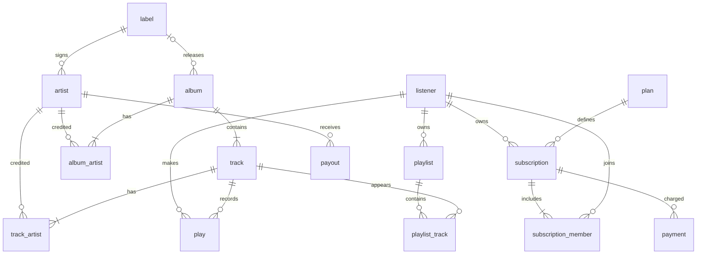

# Music Streaming

A small FastAPI music-streaming backend demonstrating how PostgreSQL, MongoDB,
and Redis can each serve a different part of a data-intensive application.
PostgreSQL is the transactional source of truth, MongoDB stores playback events
and report read models, and Redis handles short-lived playback state and fast
chart reads.

## Stack

- **FastAPI, SQLAlchemy, Alembic, Python 3.12** for the API, relational access,
  and versioned schema migrations.
- **PostgreSQL 16** for the catalogue, listeners, subscriptions, playlists,
  plays, payments, and payouts. Constraints and triggers protect critical
  invariants.
- **MongoDB 7** for playback-event documents and derived report collections.
- **Redis 7** for expiring playback state and derived charts.
- **Docker Compose** runs the databases, API, and DbGate UI together.

The relational database is the source of truth for business records.
MongoDB's report collections and Redis' charts are derived from PostgreSQL.
This keeps transactional rules in PostgreSQL while letting document and
key-value workloads use the stores best suited to them.

## Run from a clean clone

Requirements: Docker Compose and `uv`.

```bash
./scripts/run.sh
```

The first run creates `.env` from `.env.example`. For anything other than a
local demo, replace all placeholder passwords in `.env` before starting. The
launcher starts PostgreSQL, MongoDB, and Redis; runs `scripts/setup.sh`; then
builds and starts the app.

Seed the full fixture and refresh the derived MongoDB and Redis data:

```bash
./scripts/run.sh seed
```

The PostgreSQL seed replaces existing fixture data and asks for confirmation.
Do not pass `--yes` unless you intend to replace it. The seed then populates
MongoDB, exports reports, and rebuilds Redis.

Useful URLs:

- API and interactive OpenAPI docs: <http://localhost:8000/docs>
- Health check: <http://localhost:8000/health>
- DbGate: <http://localhost:3000>

Stop services without deleting their data with `./scripts/run.sh down`. The
`reset` command deletes all Compose volumes and all database data.

## Concurrency tests

Run the real-mode tests against the running app:

```bash
set -a
source .env
set +a
uv run --project app python scripts/concurrency_test.py \
  --mode real --base-url http://127.0.0.1:8000
uv run --project app python scripts/concurrency_playlist_test.py \
  --mode real --base-url http://127.0.0.1:8000
```

These tests create PostgreSQL fixtures with `ct-family-` and `ct-playlist-`
identifiers. The family test leaves its fixture for the next run to replace;
the playlist test cleans up its own fixture. Run them against a development
database, not production. Naive mode intentionally disables database guards
and is only for a disposable database.

## API

Requests that act on behalf of a listener use the `X-User-Id` header. This is
for the project exercise only; it is not authentication.

| Method | Path | Purpose |
|---|---|---|
| GET | `/catalogue/tracks/search?q=...` | Search track titles |
| GET | `/catalogue/albums/{album_id}` | Album, artists, and ordered tracks |
| GET | `/catalogue/artists/{artist_id}` | Artist and albums |
| GET | `/charts?country=PT` | Today's global or country chart |
| GET | `/charts/last50/{listener_id}` | Listener's recent tracks |
| POST | `/payouts/close` | Close a payout month |
| GET | `/reports/listeners/{listener_id}/yearly-summary/{year}` | Listener yearly summary |
| GET | `/reports/artists/{artist_id}/streams` | Artist streams by country/month |
| GET | `/reports/genres/top?country=PT&month=2026-10` | Top genres for a country/month |
| POST | `/subscriptions/join` | Join a plan with an invite code |
| POST | `/playback/start` | Start a play |
| POST | `/playback/heartbeat` | Renew playback activity |
| POST | `/playback/report` | Report completed playback |
| POST | `/playback/skip` | Skip the current track |
| POST | `/playlists/{playlist_id}/tracks` | Add a playlist track |
| DELETE | `/playlists/{playlist_id}/tracks/{position}` | Remove a playlist track |
| PATCH | `/playlists/{playlist_id}/tracks/{position}` | Move a playlist track |

The full request and response schemas are available at `/docs`.

### PostgreSQL ER diagram



See the [detailed split ER diagram](database/er-diagram-split.md).

## Current implementation notes

The project is still a coursework implementation, not a production-ready
service. In particular, the subscriptions router currently implements joining
an existing plan, but not the subscribe, cancel, or monthly-charge operations
described in the brief. The playback report/skip code attempts to update
`play`, while `music_app` is intentionally denied `UPDATE` on that table; those
flows need a design change before they can be considered working. See
[architecture and known limitations](docs/architecture.md). Chart keys also
require an explicit rebuild after new plays, and report collection validators
are not currently installed by setup.

## Documentation

- [Architecture and data ownership](docs/architecture.md)
- [Backup and recovery runbook](docs/runbook.md)
- [PostgreSQL schema and rules](docs/postgres.md)
- [MongoDB collections and reports](docs/mongodb.md)
- [Redis keys, persistence, rebuild, and verification](docs/redis.md)
- [Concurrency model and test evidence](docs/concurrency.md)
- [AI-use record](docs/ai-usage.md)
- [Project brief](docs/project/brief.md)
- [Music-streaming requirements](docs/project/music.md)
- [Task assignments and checklist](docs/project/tasks.md)

## Authors

| Name | GitHub user | Git author email |
|---|---|---|
| Leo | leodexdev | 235762230+leodexdev@users.noreply.github.com |
| Tiago | RonaldoGoatSii | tiagolinsbrasileiro@gmail.com |