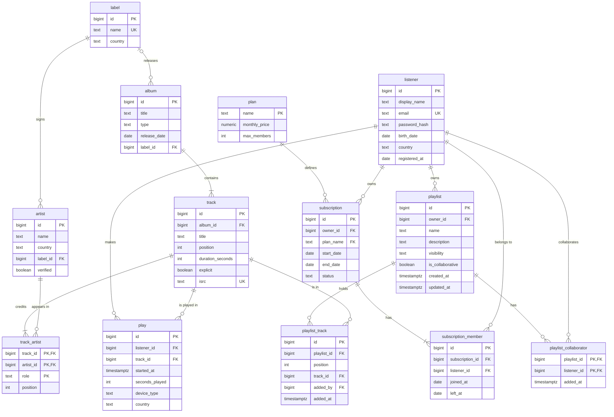
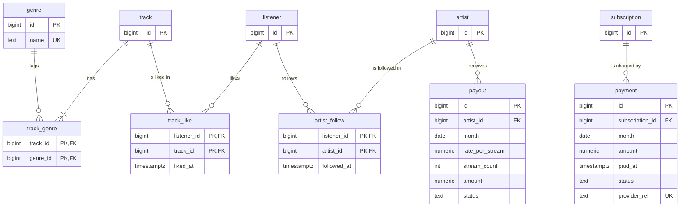

# ER diagram: primary and secondary tables

**Rule used for the split:** primary tables are the ones the rest of the schema depends on, plus the two concurrent flows. Secondary tables are "leaves": nothing else points to them, so they can be added in later migrations.

## Primary tables (13)

## Secondary tables (6)

The boxes with only `id` are primary tables, shown just so the links are visible.

## Suggested migration order

1. **Migration 1 (primary):** `label`, `artist`, `album`, `track`, `track_artist`, `listener`, `plan`, `subscription`, `subscription_member`, `play`, `playlist`, `playlist_collaborator`, `playlist_track`.
2. **Migration 2 (secondary):** `genre`, `track_genre`, `track_like`, `artist_follow`, `payment`, `payout`.