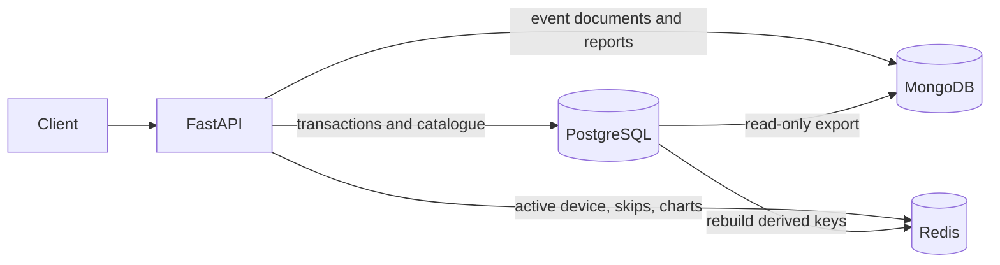

# Architecture and data ownership

## System overview

The API uses SQLAlchemy/Alembic for PostgreSQL, PyMongo for MongoDB, and
redis-py for Redis. Docker Compose provides the three stores and the app.
PostgreSQL owns durable business facts and their integrity rules. MongoDB and
Redis contain the event/read models described below; neither replaces the
relational source of truth for subscriptions, plays, or payouts.

## Source-of-truth and recovery table

| Data | Authoritative store | Copies/derived data | If copies disagree | If that engine is lost |
|---|---|---|---|---|
| Catalogue, listeners, plans, subscriptions, membership, payments, playlists, completed play rows, payouts | PostgreSQL | Some catalogue/play fields are repeated in MongoDB reports or events; chart aggregates are in Redis | PostgreSQL wins | Restore PostgreSQL backup; losing it without a backup loses the core business records |
| Playback event trail (`start`, `heartbeat`, `pause`, `seek`, `skip`, `end`) | MongoDB `playback_events` | Some final play facts are also recorded in PostgreSQL | PostgreSQL's `play` row wins for stream counts and payouts; MongoDB is the event trail | Events within the retention window are lost unless restored from a MongoDB backup |
| Listener-year, artist-country-month, and genre-country-month reports | PostgreSQL inputs; MongoDB collections are derived | MongoDB: `listener_month_stats`, `artist_country_month`, `genre_country_month` | Re-export from PostgreSQL | Rebuild by rerunning `mongodb/export.py`; source plays remain in PostgreSQL |
| Global/country charts, daily stream counters, last-50 histories | PostgreSQL `play` rows; Redis keys are derived | Redis `charts:*`, `streams:*`, `last50:*` | PostgreSQL wins | Rebuild with `redis/rebuild.py` |
| Active device and hourly skip counter | Redis | No durable copy | Redis value is authoritative while its TTL is live | Current session/skip state is lost; clients must resume and temporary keys expire |
| Optional variable track details | MongoDB `track_details`, keyed by PostgreSQL `track_id` | PostgreSQL holds the stable track identity | PostgreSQL wins for identity; MongoDB owns these optional fields | Details are lost without MongoDB backup; this collection is not currently used by the API |

`playback_events` documents reference PostgreSQL listeners/tracks by numeric ID
rather than embedding their full records. Report documents embed the small
track/day details needed by their read patterns. Report collections are
snapshots: they can be stale until the export is run again.

## How data moves

| Flow | Store sequence |
|---|---|
| F1 catalogue | API reads PostgreSQL. |
| F2 subscription lifecycle | Intended to be PostgreSQL-only; subscribe, cancel, and monthly charge endpoints are not currently implemented. |
| F3 join plan | API checks and inserts in PostgreSQL in one transaction; the subscription row lock and database capacity trigger serialize joins. |
| F4 playback | Start checks PostgreSQL, sets the Redis active-device key, inserts the initial `play` row, then inserts a MongoDB `start` event. Heartbeat refreshes Redis and inserts a MongoDB event. Report/skip currently attempt to update the PostgreSQL `play` row and then append a MongoDB event. This has a permissions conflict described under known gaps. |
| F5 playlist edit | API performs the edit in a PostgreSQL transaction, locking the playlist row. |
| F6 charts | API reads the required Redis keys only. `redis/rebuild.py` derives chart keys from PostgreSQL; no per-play chart update is currently wired into the playback API. |
| F7 payout close | API aggregates qualifying PostgreSQL plays and writes payout rows in PostgreSQL in one transaction. |
| F8 reports | `mongodb/export.py` reads PostgreSQL using `music_ro`, then replaces the report collections in MongoDB. Report endpoints read MongoDB only. |

### Cross-engine failure behavior

There is no distributed transaction across PostgreSQL, MongoDB, and Redis.
Each flow commits to its first store before writing to the next, so a later
store failure can leave partial state:

- If PostgreSQL fails after the playback start updates Redis, the Redis
  active-device key remains until its 60-second TTL expires.
- If MongoDB fails after a PostgreSQL play insert commits, the play row remains
  but its corresponding event document is missing.
- If a report write fails after a PostgreSQL change, PostgreSQL remains the
  authoritative record; the client must receive an error and retry/reconcile.
- MongoDB report collections can be regenerated from PostgreSQL. Redis
  derived keys can be regenerated with `redis/rebuild.py`.

## Time-dependent state

- Payout month boundaries and chart days use `Europe/Lisbon`.
- A Redis `active_device:{listener_id}` key expires after 60 seconds and is
  renewed by heartbeats.
- The skip counter uses a fixed UTC-hour key and expires after one hour.
- Invite-code expiry is stored in PostgreSQL as `expires_at` and checked by
  the API; it is not a Redis TTL.
- Playback event documents expire after 30 days through MongoDB's TTL index.
- Monthly reports cover a rolling 12-calendar-month PostgreSQL window and are
  refreshed by an explicit export command. There is no scheduled worker.
- Monthly charges and payout closes are explicit API operations; there is no
  background scheduler.

## Security

- PostgreSQL `music_owner` runs migrations; `music_app` is the API role;
  `music_ro` is used by analytics/export jobs.
- MongoDB root credentials are for setup only; the app uses `music_app` with
  `readWrite` on the `music` database.
- Redis requires a password from `.env`.
- Secrets belong in `.env`, which is ignored by Git; `.env.example` contains
  placeholders.
- The app has no authentication by design. `X-User-Id` identifies the actor
  for project flows but does not prove that the caller owns that identity.
  Do not expose this service as a production API.

## Known gaps found during final validation

- The brief requires subscribe, cancel, and monthly-charge operations (F2),
  but the current subscriptions router only has `POST /subscriptions/join`.
- The app role has `INSERT` but not `UPDATE` on `play`. The playback report and
  skip services issue `UPDATE play`, so those operations fail at the database
  privilege check. This must be reconciled with the brief's rule that app
  writes to `play` are append-only before F4 can be called complete.
- The chart endpoints read Redis correctly, but playback does not update the
  derived chart keys per stream. Charts change only after a Redis rebuild.
- MongoDB setup validates `playback_events` and `track_details`; the exported
  report collections do not currently get validators from setup.